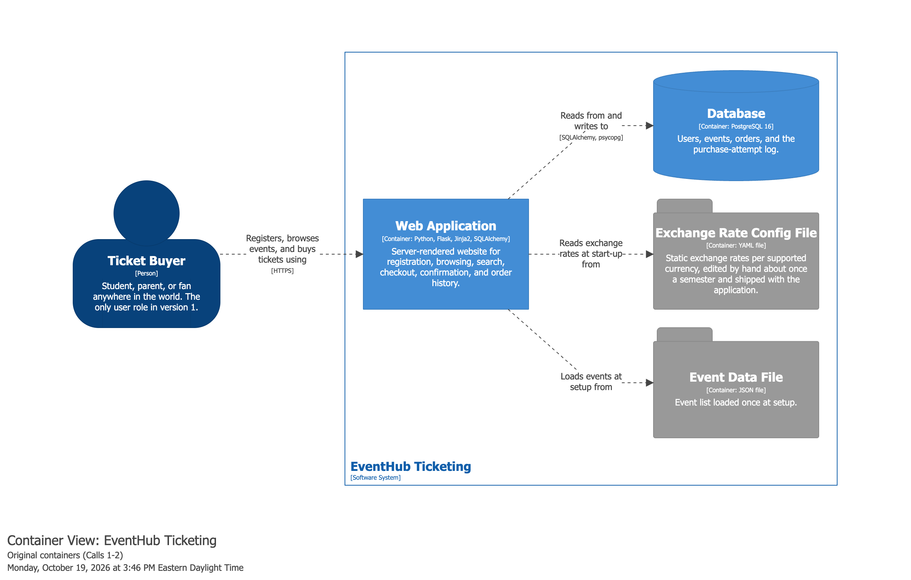
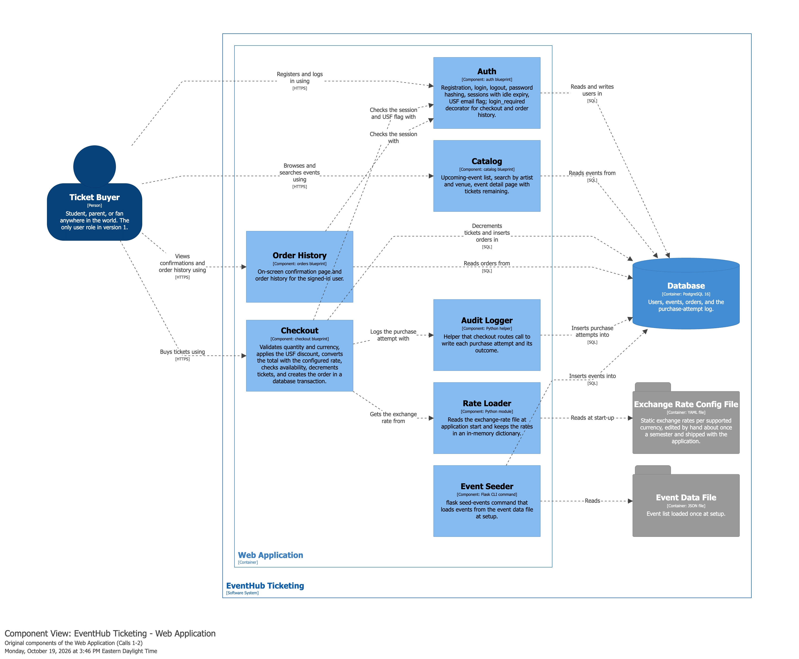
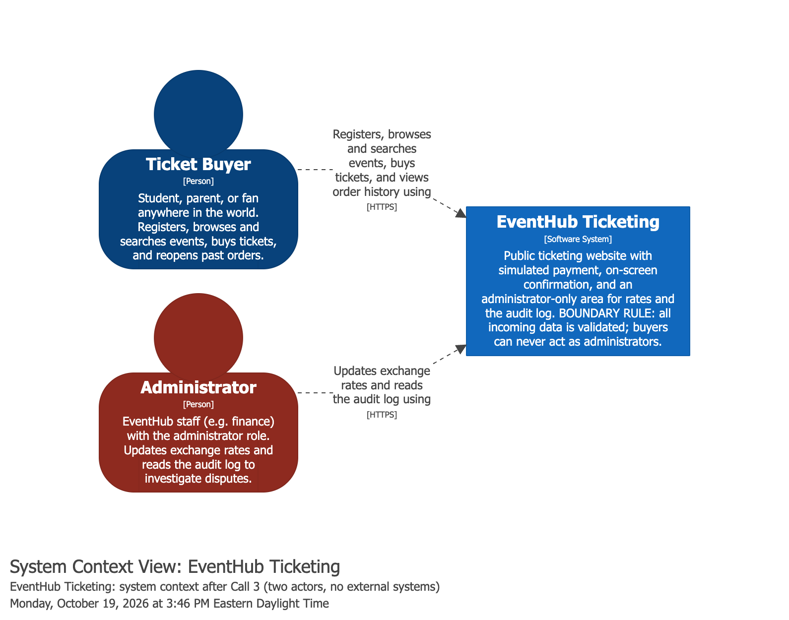
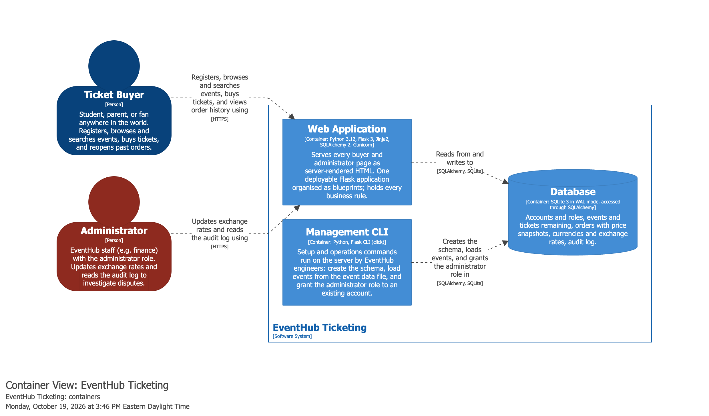
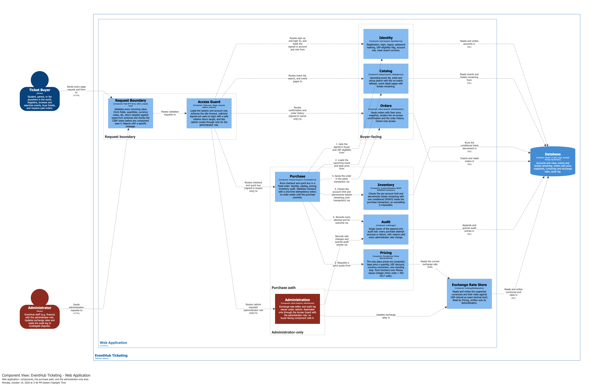
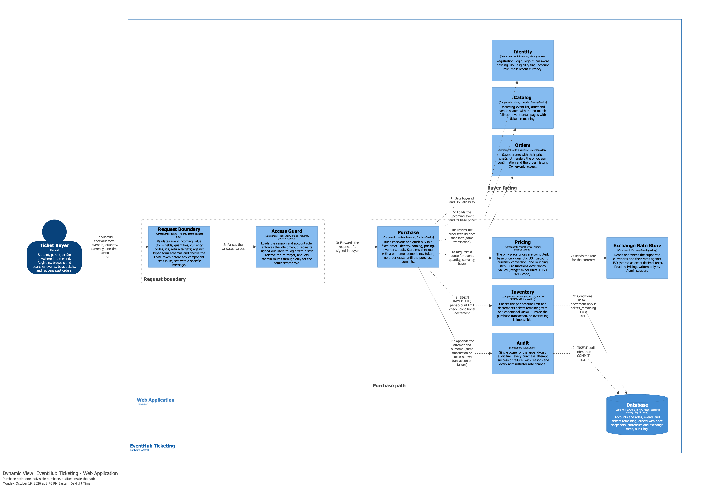

# CEN 4020 EventHub AI Project — Part 3: Assignment Report

**Team:** babyruth (Gold) — Quang Minh Tran, Danae Ferguson  
**Repository:** https://github.com/f26-cen40201-EventHub/babyruth  
**In the repository:** `workspace.dsl`, `diagrams/`, `features/*/requirements.md`

---

## 1. How we produced the design

Danae went back through the Call 1, Call 2 and Call 3 transcripts and pulled out every detail that affects the design: who said what, which questions were decided, and which were left open. I made the design decisions and drove the GenAI tool.

For the **original design** we gave the GenAI tool (Claude Code, model Claude Opus 5.5) only what existed before Call 3:
- our chosen Part 2 context diagram (Option A, minimal context) as Structurizr DSL,
- our corrected EARS requirements from Part 1,
- the Call 1 and Call 2 transcripts.

We asked it to break the context diagram down into C4 container and component diagrams for the Flask application, and to make the decisions the calls left open, such as the database and the interfaces between components. Section 2 shows the result, unchanged. Its source is `submissions/ai-project-part-3/original/original-workspace.dsl`.

We then reviewed Call 3, decided what it changes, and produced the **final design** in Section 4:
- new context, container and component views, plus a dynamic view of the purchase path, in `workspace.dsl`,
- updated EARS requirements in `features/`,
- a written decision for each design fork, with its reasoning,
- a developer-level design: interfaces, data structures and algorithms.

Before anything went into the repository we checked it in three ways:
- **Requirements:** read line by line against the transcripts, then run through the instructor's `grading/check_part3.py`, which passes.
- **Diagrams:** rendered and validated with Structurizr. The DSL passes `structurizr validate`.
- **Diagram contents:** compared element by element with what was said in the calls.

---

## 2. Original C4 Container and Component diagrams (GenAI, from Calls 1 and 2)

### 2.1 Original container diagram

| Container | Technology | Purpose |
|---|---|---|
| Web Application | Python, Flask, Jinja2, SQLAlchemy | Every page: registration, browsing, search, checkout, confirmation, order history |
| Database | PostgreSQL 16 | Users, events, orders, purchase-attempt log |
| Exchange Rate Config File | YAML | Static rates, edited by hand about once a semester and shipped with the app (Call 1: "Static rates in a config file") |
| Event Data File | JSON | Events loaded at setup (Call 2: "Events get loaded from a data file at setup") |

One actor, the Ticket Buyer, uses the Web Application over HTTPS. There are no external systems, which matches our Part 2 context diagram.

### 2.2 Original component diagram

| Component | Responsibility |
|---|---|
| Auth | Registration, login, sessions with idle expiry, USF email flag, `login_required` |
| Catalog | Event list, search by artist and venue, event detail page |
| Checkout | Validates quantity and currency, applies the discount, converts with the configured rate, checks availability, decrements tickets, creates the order in a transaction |
| Rate Loader | Reads the YAML rates file at start-up into a dictionary |
| Order History | Confirmation page and order history |
| Audit Logger | Helper that the checkout route calls to log each attempt |
| Event Seeder | `flask seed-events` command that loads the JSON event file |

### 2.3 What we found wrong with the original design

Some problems in the original design came from information we only got in Call 3. Others were mistakes the AI made with the information it already had, and we would have had to fix those anyway:

1. **"Decrements tickets in a transaction" does not prevent overselling.** Under PostgreSQL's default isolation level (read committed), two transactions can both read "1 ticket left" and both decrement. A transaction alone is not enough. The decrement itself has to be conditional. The AI wrote a sentence that sounds safe but answers the exact Call 2 concern ("we've sold a ticket that doesn't exist") in name only.
2. **PostgreSQL was picked by default, with no numbers.** Nothing in Calls 1 or 2 justified running a database server at launch, and there was no decision record. Priya had asked for one in Call 2.
3. **The money representation was never chosen.** Kenji's yen question from Call 1 was already on the table, yet the original design says nothing about how amounts are stored or rounded.
4. **Checkout did five jobs**: validation, discount, conversion, stock decrement and order creation. Any change to pricing would mean editing the same component that guards inventory.
5. **The Audit Logger was optional.** A logging helper that routes call only works if every route remembers to call it. The double-click quick buy would have been a second route that had to remember.
6. **Kenji's boundary rule was not visible.** The buyer had arrows straight into every component, so there was no single place where validation happens.

---

## 3. Changes to requirements, modeling, and design after Call 3

### 3.1 What was new in Call 3

The most important thing in Call 3 was not a decision but a new fact. Finance now expects to change exchange rates monthly, sometimes weekly, and Marcus said that editing a file and releasing the app every time "is not workable". Finance wants to log in and change the number on a screen. Once someone logs in to change rates, that person is not a buyer. Priya called it an administrator, a second role with permissions a buyer must never have. That one fact overturned the Part 2 conclusion that EventHub has a single human actor, and the change reaches all three C4 levels. Thuy then pointed out that nobody had ever said how the audit log gets *read*, so the log viewer joined the same admin area.

Call 3 also closed several questions that had been open:
- **No-match search:** a message, then the full event list, with the search text treated as plain text.
- **Signed-out users on checkout or order history:** redirect to login, then back to the page they asked for, with nothing shown or recorded before login.
- **Audit logging:** part of the purchase path, owned by one component.
- **Pricing:** lives in exactly one component.

Some points came in as constraints, not solutions, and left the design work to us: Kenji's warning about decimal money, Marcus's request to "lock in" buyers during checkout, and Priya's database fork.

Some things stayed open: who becomes an administrator and how, the session timeout (Kenji and Marcus repeated the same argument), and whether the discount comes off before or after conversion.

### 3.2 How the requirements changed

We reorganised the requirements into one folder per component under `features/`, plus `features/system/` for rules that apply everywhere (boundary validation, session expiry, HTTPS, performance). When Call 3 rewrote a requirement, we did not edit it in place. The new version got a new ID and the old one was marked superseded, so a reviewer can see what changed:

- **pricing-002 → pricing-008.** Rates no longer come from "the exchange-rate configuration file". They come from the database when the price is computed. Editing them is covered by admin-004 to admin-007, including what counts as a valid rate and keeping USD fixed at 1.
- **identity-008 → identity-012.** "Deny access and redirect to login" became "redirect to login and keep the requested page as the return target". We added:
  - identity-013: send the user back to that page after login,
  - identity-014: ignore return targets that point off-site, which closes an open-redirect hole the meeting did not mention but that the redirect creates,
  - identity-015: show nothing before login, even for a link pasted into the address bar, as Kenji required.

New requirements cover the administrator role (identity-009 to identity-011, admin-001 to admin-003, admin-010), the audit viewer (admin-008 and admin-009), audit ownership (audit-003 to audit-006), the no-match search (catalog-008 and catalog-009), pricing in one place and money (pricing-005 to pricing-007, pricing-009 and pricing-010), abandoned checkouts (purchase-013 to purchase-017), and the fixed order of the purchase path (purchase-018).

We also removed one requirement. In Part 1 we kept "the confirmation page shall prevent screenshots" because Darnell asked for it and Marcus said "noted". Looking at it again as designers, no web page can stop the phone's operating system, or a second phone, from capturing the screen, so no test could ever pass it. Keeping it would only hide the real problem, which is Thuy's question of what door staff actually check. Both are now tracked as open items, so the problem is recorded instead of covered by a requirement that can't be met.

### 3.3 How the model changed

**Context.** There are now two people, the Ticket Buyer and the Administrator. We considered whether the rates decision adds an external system and concluded it does not, because administrators type the rates in. Payment is still simulated and confirmation is still on screen only. The system still has no external dependencies.

**Containers.** The original design had two file containers, one for rates and one for events. The rates file is gone. Rates are now a table in the database, so the rates decision gave the web application new admin-facing *routes* rather than a new store. That matches Priya's prediction that the container level "gains admin-facing routes". Loading events and granting the admin role both need a tool that runs on the server, so they became a **Management CLI** container. The database changed from PostgreSQL to SQLite in WAL mode. Section 3.4 explains why that is a deliberate choice and not a downgrade.

**Components.** This is where most of the rework happened:
- **Checkout split into three.** Purchase orchestrates, Pricing does all money maths, and Inventory does the atomic decrement. Priya's argument for one pricing component convinced us: the discount-order question is still open, and when it is answered it should be a one-place change, not "fix four of the five and find the fifth in production".
- **Audit moved into the path.** The Audit Logger that sat beside Checkout became **Audit**, step 5 of the purchase path. That is Thuy's point that logging should be impossible to skip.
- **Administration added.** It handles rates and the audit viewer. Only the Access Guard can reach it, and only for the administrator role. No buyer-facing component calls it. The diagram groups it separately and colours it red, so "which components only administrators can reach" is visible at a glance.
- **Request Boundary and Access Guard added** in front of everything, so Kenji's boundary rule from Call 2 is one component instead of a promise in every route.
- **A dynamic view** shows the purchase path step by step, because Priya said that is where the mistakes will be.

### 3.4 How the design changed

Priya said a well-argued decision record matters more than a pretty diagram, so we wrote down each fork and the reasoning behind it:

- **Database.** We chose SQLite in WAL mode, with each purchase in a short `BEGIN IMMEDIATE` transaction, and wrote the load numbers next to the decision as Priya asked. A purchase is about four small statements, roughly 1–5 ms. So in Priya's worst case, 200 buyers pressing buy in the same second, the last buyer waits about a second. That is inside our 3-second target and is what Kenji meant by "they queue, briefly". SQLite's one-writer-at-a-time behaviour also makes the inventory guarantee easier to reason about. Everything goes through SQLAlchemy, and we listed the conditions that would move us to PostgreSQL: slow purchases at a release, needing more than one server, or sales data showing much bigger bursts.
- **Money.** Amounts are whole numbers of the smallest unit (cents, or yen) stored with the currency's number of decimal places. Rates are exact decimals. We round once, at the end, and never use floats. This is the "deliberate choice" Kenji asked for, so the yen problem cannot appear silently months from now.
- **Rates.** A database table, edited on the admin screen, with every change audited. A buyer who saw the old price is shown the new total before paying.
- **Administrator.** Kenji asked "is it a flag, a role, a separate login?" and Marcus said "we'll figure out the mechanism". We could not build an admin area without an answer, so I made one: a role column, granted only by a command run on the server, never through the website. A compromised buyer account therefore cannot become an admin. I marked it as needing Kenji's sign-off.
- **Inventory.** One conditional `UPDATE … WHERE tickets_remaining >= q`, with the per-account limit check in the same transaction. Two buyers can never both get the last ticket, and a scalper sending ten orders at once cannot get past the limit.
- **Audit.** Written in the same transaction as a successful purchase. If it can't be written, the purchase rolls back. The log is append-only and readable in the admin viewer.
- **Abandoned checkouts.** We did not build Marcus's lock-in. Browsers do not let a page disable the back button or stop a tab closing, and trapping students works against Darnell's two-minute goal. Priya had already separated the need ("handle abandoned checkouts cleanly") from the treatment. Our treatment: the checkout writes nothing to the database until the purchase succeeds, and a one-time token stops duplicate orders when someone double-submits or presses back. Marcus gets clean data and can still measure abandonment.

We then turned all of this into something a developer can build: the HTTP routes, each component's Python interface, the tables, the data structures, the error message for each failure, and the algorithms (summarised in section 4.5).

### 3.5 What is still open

Some questions are business decisions that the calls have not made, and we did not want to quietly make them ourselves. So they became configuration values with safe defaults:
- the session idle timeout (30 minutes, Kenji's value, until Adaeze decides),
- the discount amount (0 until Darnell sends the number),
- the purchase limits (4),
- the currency list (USD, EUR, GBP, JPY).

The discount being applied in USD before conversion is a provisional design choice, and the admin mechanism is a proposal. We keep all of these on an open-items list, so the next call has a concrete list to settle.

---

## 4. Final C4 diagrams (after Call 3)

### 4.1 Context

Two actors, the **Ticket Buyer** and the **Administrator**. One software system, EventHub Ticketing, with no external systems.

### 4.2 Containers

| Container | Technology | Purpose |
|---|---|---|
| Web Application | Python 3.12, Flask 3, Jinja2, SQLAlchemy 2, Gunicorn | Every buyer and admin page; all business rules |
| Database | SQLite 3 (WAL) | Accounts and roles, events and stock, orders with price snapshots, currencies and rates, audit log |
| Management CLI | Flask CLI | Create the schema, load events, grant the admin role |

### 4.3 Components

| Component | Responsibility | Reachable by |
|---|---|---|
| Request Boundary | Validates every incoming value and the CSRF token | everyone |
| Access Guard | Session, idle timeout, login redirect with a safe return target, admin check | everyone |
| Identity | Register, login, logout, password hashing, USF flag, role | public |
| Catalog | Event list, search with no-match fallback, event pages | public |
| Purchase | Runs the purchase path; stateless, idempotent checkout | signed-in buyers |
| Pricing | The only place prices are computed | via Purchase |
| Inventory | Atomic limit check and decrement | via Purchase |
| Orders | Saves orders, confirmation, history | owner only |
| Audit | Append-only audit trail | via Purchase and Administration |
| Exchange Rate Store | Currencies and rates | read by Pricing, written by Administration |
| **Administration** | Rate editor, audit viewer | **administrators only** |

### 4.4 Purchase path (dynamic view)

The order is identity → catalog → pricing → inventory → audit, as Priya described. The decrement, the order insert and the audit entry are committed together in one transaction.

### 4.5 Data structures, algorithms and interfaces (summary)

- **Data structures:** `Money(minor:int, currency)`, `PriceQuote`, `PurchaseRequest`, `PurchaseOutcome` (one error message per value), `ClaimResult`, `SearchResult`. Tables: `accounts`, `events`, `currencies`, `orders`, `audit_entries`.
- **Algorithms:**
  - the single-rounding price quote,
  - the atomic conditional decrement,
  - the always-audited purchase path,
  - case-insensitive search with fallback,
  - the sliding idle timeout,
  - return-target validation,
  - idempotent checkout tokens.
- **Interfaces:** HTTP routes for each page and admin action (for example `POST /checkout/<event_id>` and `POST /admin/rates/<code>`), and a Python service interface per component (for example `PricingService.quote(event, quantity, currency, buyer) -> PriceQuote` and `InventoryRepository.claim(...) -> ClaimResult`).

---

## Appendix

- Final DSL: `workspace.dsl` (repository root). Original DSL: `submissions/ai-project-part-3/original/original-workspace.dsl`.
- Requirements: `features/*/requirements.md` (9 folders, 88 requirement lines, 2 superseded).
- Eligibility check: `python3 grading/check_part3.py .` reports `ELIGIBLE for grading`.
- Note on tooling: the `structurizr/lite` Docker image is deprecated and now exits at start-up after printing a migration notice. We opened and exported the workspace with its official replacement, `structurizr/structurizr local`, and validated both DSL files with `structurizr validate`. The export file names keep the `structurizr-1-<view-key>.png` pattern.
